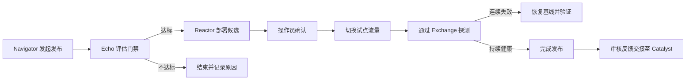

# Cyrene Release Pilot

**Cyrene 原生 Go 插件，面向模型版本的试点发布、切流与回滚。**

从 Navigator 发起发布后，插件调用 Echo 评估候选模型，将达标制品部署到 Reactor，并等待操作员确认。确认后，测试流量通过 Exchange 切到候选版本。候选连续探测失败时，插件恢复基线。人工审核过的错例可以交给 Catalyst，进入下一轮数据准备。

例如，更新客服工单分类模型时，可以用同一份标注集比较新旧版本。新版达标后，操作员确认切流。若新版接口持续超时，插件自动恢复旧版，并记录回滚结果。

## 发布流程



| 环节 | 当前行为 |
| --- | --- |
| 评估 | Echo 比较同一数据集版本中的 100 条样本。候选须覆盖全部样本、精确匹配率至少为 90%，且得分不低于基线。部署沿用评估报告绑定的模型制品摘要。 |
| 切流 | 操作员确认绑定候选摘要、评估结果和路由版本的快照。插件更新本地 `release-pilot` 别名，测试请求经 Exchange 转发到选中的模型。 |
| 回滚 | 每 5 秒探测一次，连续 3 次失败后恢复基线并验证响应。候选持续健康 60 秒后成为下一次发布的基线。 |
| 反馈 | 操作员从独立的 Echo 评估运行中选择已审核的更正。插件导出到 Catalyst 的待审核数据准备任务，并保存交接回执。 |
| 恢复 | 发布进度和路由版本保存在 Platform 注入的插件私有目录。进程重启后继续核对原操作，相同提交键复用原发布记录。 |

## 兼容性与验证结果

- 插件 ID 为 `cyrene.tools.release-pilot`，通过 gRPC `DirectPluginRuntime` 提供 Cyrene `tool.provider.v1` 能力，由 Platform Package Runtime 安装与激活。
- 打包脚本支持 Linux amd64 与 arm64。运行构建脚本需要 Go 1.25 或更新版本、Python 3.12 和用于 Go 竞态检测的 C 编译器。安装预构建包时，由 Python 准备脚本校验并暂存静态 Go 二进制。
- Linux amd64 无 GPU 演练使用真实 Cyrene 服务和固定的模拟模型输出。90% 的基线与 95% 的候选通过评估，85% 的候选、缺失样本及制品摘要不符均被拦截。注入候选故障后 **17.84 秒**恢复基线。5 条审核反馈进入 Catalyst `MAPPED` 任务，重复交接返回同一回执。
- 当前验收范围为隔离环境中的单绑定、非流式 Chat 试点和发布控制链。真实推理性能、模型质量及生产容量需要在目标环境验证。

## 构建与安装

从本仓库根目录运行构建脚本。

```bash
tools/build.sh
```

脚本先运行 Go 静态检查和竞态测试，再将 ZIP 与配套 descriptor 输出到 `dist/`。使用 `--output` 可以指定目录。`CYRENE_GO` 和 `CYRENE_PYTHON` 可指定本机的工具链可执行文件。GitHub Actions 使用同一构建入口。

1. 将 ZIP 和配套 descriptor 交给 Platform Package Runtime 安装。为此安装配置可信的 [Go 二进制准备脚本](tools/prepare-static-go.py)。Platform 校验归档和依赖锁，准备脚本校验二进制摘要并设置执行权限。
2. 按 [配置 schema](configuration.schema.json) 准备宿主配置。登记基线和候选的 Echo 输入、模型制品、Reactor serving binding 及 Exchange provider binding。隔离网关需已有健康的基线路由，并使用精确别名。
3. 激活名为 `release-pilot` 的 `tool.provider.v1` 版本 1 绑定。将 `CYRENE_RELEASE_PILOT_CONFIG_FILE` 指向宿主配置的绝对路径。Platform 注入 `CYRENE_CAPABILITY_BINDING_ID` 和 `CYRENE_PLUGIN_STORAGE_PATH`，并返回 `connection_ref`。
4. 将 [Navigator 绑定示例](navigator.binding.example.json) 合入持久化服务的 principal 配置，并将 `CYRENE_RELEASE_PILOT_CONNECTION_REF` 设为激活结果。Navigator checkout 需要包含 Release Pilot 桥接改动，绑定的组织与工作区需具有授权写入者。发起发布时沿用 Navigator 的写入审批策略。

插件的 `httpListen` 使用回环地址。分别配置操作员和测试流量的 Bearer 凭据，令牌从私有文件读取。Echo、Reactor 和 Exchange 使用各自的服务连接配置。

## 日常使用

通过 Navigator 调用 `release_prepare`，提交已登记的 `candidateId` 和本次操作的 `idempotencyKey`。使用 `release_status` 查询返回的 `releaseId`。候选进入 `AWAITING_APPROVAL` 后，操作员核对评估报告和模型制品，再决定是否切流。

| 接口 | 用途 | 请求体 |
| --- | --- | --- |
| `GET /admin/releases/{id}` | 查看发布、评估、路由和反馈状态 | 空 |
| `POST /admin/releases/{id}/approve` | 确认切流，快照有效期为 30 分钟 | `snapshot` 从 `approvalSnapshot` 取得，`routeVersion` 从 `expectedRouteVersion` 取得 |
| `POST /admin/releases/{id}/refresh` | 重新检查路由与服务健康并更新审批快照 | 与审批接口相同 |
| `POST /admin/releases/{id}/feedback` | 提交已审核的 Echo 更正，查询状态可取得 Catalyst 回执 | `runId` 和 `annotationIds` |
| `POST /v1/chat/completions` | 使用试点入口发送非流式测试请求，响应携带 Exchange 请求 ID | OpenAI 兼容请求，`model` 为 `release-pilot` |

`/admin/` 接口要求操作员 Bearer，Chat 入口要求测试流量 Bearer。需要回收反馈时，在与发布基准集分开的 Echo 运行中记录并审核更正，再选择对应的标注 ID。

## 复跑无 GPU 演练

从包含 `local_package_probe` 验收入口的 Cyrene-Platform checkout 编译启动器。以下整链路演练还需要包含 Release Pilot 桥接改动的 Navigator checkout。

```bash
cargo build --locked -p cy-package-runtime --example local_package_probe
```

为各服务分别准备 Python 3.12 环境，并在下表指定的目录运行 `uv sync --frozen --group dev`。

| 服务 | 演练使用的修订 | 依赖目录 |
| --- | --- | --- |
| Echo | `5db51ca2971e` | 仓库根目录 |
| Catalyst | `1593216baebc` | 仓库根目录 |
| Exchange | `12fdd8966d06` | `product` |
| Reactor | `470cec30bc09` | `product` |
| Navigator | `4d3ed5185277` 加上 Release Pilot 桥接改动 | 仓库根目录 |

从本仓库根目录运行演练。各路径变量分别指向 checkout、启动器和 Python 虚拟环境解释器。`ARCHIVE` 与 `DESCRIPTOR` 应来自同一次构建。

```bash
python3 tools/demo.py \
  --platform-probe "$PLATFORM_PROBE" \
  --navigator "$NAVIGATOR_ROOT" \
  --navigator-python "$NAVIGATOR_PYTHON" \
  --descriptor "$DESCRIPTOR" \
  --archive "$ARCHIVE" \
  --echo-python "$ECHO_PYTHON" \
  --catalyst-python "$CATALYST_PYTHON" \
  --exchange-python "$EXCHANGE_PYTHON" \
  --reactor-python "$REACTOR_PYTHON" \
  --report "$PWD/cpu-report.json"
```

演练在临时目录中使用合成样本，启动 Platform supervisor、Navigator Work API 和四个产品服务。生成的 JSON 报告标记为 `SIMULATED`，包含插件激活代次、发现的工具、回滚耗时和反馈回执。

## 源码与许可证

能力声明见 [plugin.manifest.json](plugin.manifest.json)。使用 [生成脚本](tools/generate-wire.sh) 可从 Cyrene 中央 Protobuf 契约重新生成 Go 绑定，工具版本为 protoc 25.1、protoc-gen-go v1.36.11 和 protoc-gen-go-grpc v1.6.1。

插件采用 [Apache License 2.0](LICENSES/Apache-2.0.txt)。本仓库保留原有 [LICENSE](LICENSE)，Cyrene 插件源码及所带的 Protobuf 契约采用上面的 Apache 许可证。
